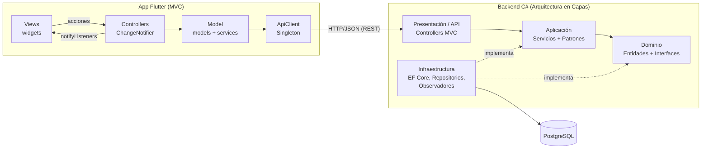
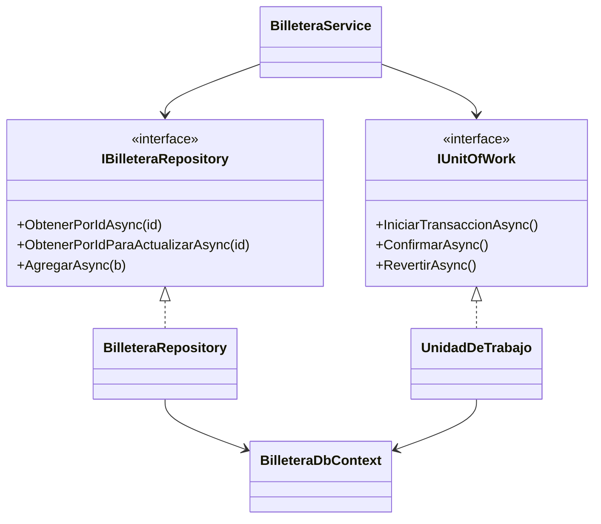
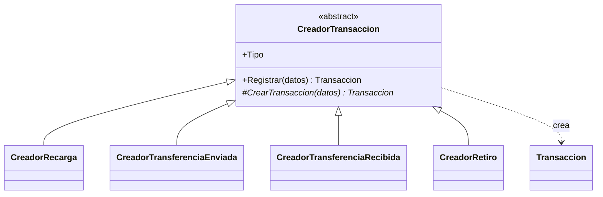
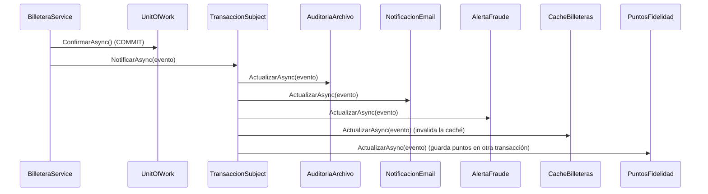
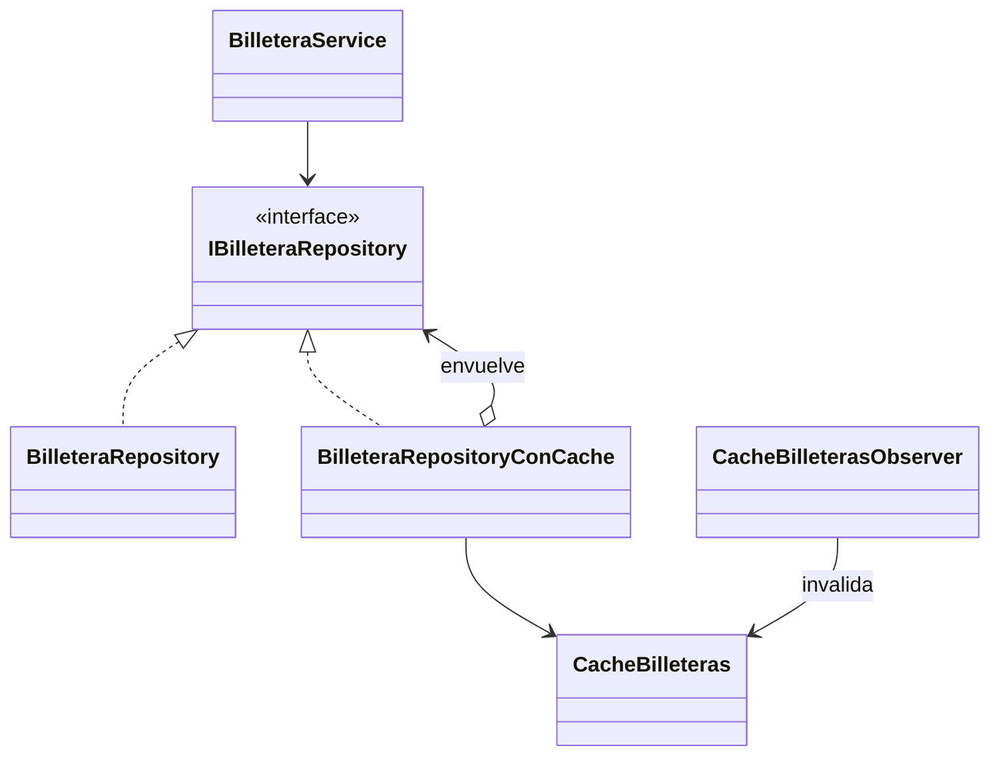

# Billetera Digital — Caso práctico de Diseño y Arquitectura de Software

Aplicación completa (backend + base de datos + app móvil) para demostrar en clase
**patrones arquitectónicos** (Capas, MVC, API REST) y **6 patrones de diseño**.

| Componente | Tecnología |
|---|---|
| Backend | C# · ASP.NET Core 8 Web API · Entity Framework Core 8 |
| Base de datos | PostgreSQL 16 |
| Frontend | Flutter 3 (Dart 3) · `http` · `provider` |
| Comunicación | API REST + JSON (errores en formato RFC 7807 *ProblemDetails*) |

Funcionalidades: **registro de clientes** (con apertura automática de billetera),
**inicio de sesión**, **recarga** y **retiro de saldo**, **transferencias** entre
billeteras con comisión, **puntos de fidelidad** e **historial de transacciones**
paginado y filtrable.

---

## 1. Arquitectura general



### 1.1 Arquitectura en capas (backend)

```
backend/src
├── BilleteraDigital.Domain          ← núcleo: no depende de NADA
│   ├── Entidades/   Cliente, Billetera, Transaccion, MovimientoPuntos  (entidades ricas)
│   ├── Enums/       TipoTransaccion
│   ├── Excepciones/ ReglaDeNegocioException, SaldoInsuficienteException
│   └── Interfaces/  IClienteRepository, IBilleteraRepository, ITransaccionRepository,
│                    IPuntosFidelidadRepository, IUnitOfWork
├── BilleteraDigital.Application     ← casos de uso; depende solo de Domain
│   ├── DTOs/        contratos de entrada/salida de la API
│   ├── Servicios/   ClienteService, BilleteraService
│   ├── Idempotencia/ IIdempotenciaRepository, RegistroIdempotencia
│   └── Patrones/    Strategy/, FactoryMethod/, Observer/
├── BilleteraDigital.Infrastructure  ← detalles técnicos; implementa las interfaces
│   ├── Persistencia/ BilleteraDbContext (EF Core), UnidadDeTrabajo
│   ├── Repositorios/ ClienteRepository, BilleteraRepository, TransaccionRepository,
│   │                 PuntosFidelidadRepository, IdempotenciaRepository,
│   │                 BilleteraRepositoryConCache (Decorator)
│   ├── Cache/        CacheBilleteras (claves, tiempos de vida e invalidación)
│   ├── Seguridad/    Pbkdf2PasswordHasher, JwtGeneradorToken
│   ├── Mantenimiento/ LimpiezaIdempotenciaService (borra claves de más de 24 h)
│   └── Observadores/ AuditoriaArchivo, NotificacionEmail, AlertaFraude, CacheBilleteras,
│                     PuntosFidelidad
└── BilleteraDigital.Api             ← presentación (MVC) y raíz de composición
    ├── Controllers/  ClientesController, BilleterasController, TransaccionesController
    ├── Middleware/   ManejoErroresMiddleware + TraductorErrores (excepción → código HTTP)
    ├── Filtros/      IdempotenciaFilter, [Idempotente] (cabecera Idempotency-Key)
    └── Configuracion/RegistroAplicacion (inyección de dependencias)
```

**Regla de dependencia:** las flechas de `ProjectReference` apuntan siempre hacia el
Dominio. Aplicación define *qué* necesita (`IUnitOfWork`, `IPasswordHasher`) e
Infraestructura decide *cómo* (EF Core, PBKDF2). Esto es el **Principio de
Inversión de Dependencias** y permite, por ejemplo, cambiar PostgreSQL por otra
base de datos sin tocar una línea de los casos de uso.

> 💡 Demostración para clase: durante el desarrollo se validó la API reemplazando la
> capa de Infraestructura por repositorios en memoria. Controladores y servicios no
> cambiaron. Es la mejor prueba de que las capas están bien desacopladas.

### 1.2 MVC

| | Backend (ASP.NET Core) | Frontend (Flutter) |
|---|---|---|
| **Model** | DTOs (`Application/DTOs`) + entidades | `lib/models` + `lib/services` (acceso REST) |
| **View** | Representación JSON que devuelve la API | `lib/views` (widgets: solo dibujan) |
| **Controller** | `Api/Controllers` (reciben HTTP, delegan, responden) | `lib/controllers` (`ChangeNotifier`) |

Los controladores de ambos lados son **delgados**: no tienen reglas de negocio ni
SQL / URLs. En Flutter, la View invoca al Controller (`context.read`), el Controller
llama al Model y avisa con `notifyListeners()`, y la View se redibuja (`context.watch`).

### 1.3 API REST

| Método | Ruta | Descripción | Códigos |
|---|---|---|---|
| POST | `/api/clientes` | Registrar cliente (+ billetera) | 201, 409, 422 |
| POST | `/api/clientes/login` | Iniciar sesión | 200, 401 |
| GET | `/api/clientes/{id}` | Cliente con billetera | 200, 403, 404 |
| GET | `/api/clientes/{id}/puntos` | Puntos de fidelidad (total y últimos movimientos) | 200, 403, 404 |
| GET | `/api/billeteras/{id}` | Saldo de la billetera | 200, 404 |
| GET | `/api/billeteras/cuenta/{numero}` | Titular de una cuenta (antes de transferir) | 200, 404 |
| GET | `/api/billeteras/{id}/transacciones?pagina=&tamano=&tipo=` | Historial paginado | 200, 404 |
| POST | `/api/transacciones/recargas` | Recargar saldo ⚑ | 201, 400, 404, 409, 422 |
| POST | `/api/transacciones/retiros` | Retirar saldo (máx. S/ 2,000) ⚑ | 201, 400, 404, 409, 422 |
| POST | `/api/transacciones/transferencias` | Transferir dinero ⚑ | 201, 400, 404, 409, 422 |
| GET | `/api/transacciones/comision?monto=` | Previsualizar comisión | 200, 422 |

⚑ Exigen la cabecera **`Idempotency-Key`** (por ejemplo, un UUID). Ver la sección 2.7.
En Swagger aparece como un campo más de la operación.

Ejemplo de error (todas las capas lo producen igual gracias al middleware):

```json
{ "title": "Regla de negocio", "status": 422,
  "detail": "Saldo insuficiente. Disponible: S/ 3,995.00, requerido: S/ 9,025.00." }
```

---

## 2. Los 6 patrones de diseño

| # | Patrón | Tipo (GoF / PoEAA) | Problema que resuelve aquí | Dónde verlo |
|---|---|---|---|---|
| 1 | **Repository** (+ Unit of Work) | Arquitectónico / PoEAA | Aislar el acceso a datos y guardar débito + crédito + movimientos de forma atómica | `Domain/Interfaces`, `Infrastructure/Repositorios`, `Infrastructure/Persistencia/UnidadDeTrabajo.cs` |
| 2 | **Strategy** | Comportamiento | La comisión cambia según el monto (y podrá cambiar por promociones, tipo de cliente…) | `Application/Patrones/Strategy` |
| 3 | **Factory Method** | Creacional | Cada tipo de movimiento (recarga, enviada, recibida) se construye distinto | `Application/Patrones/FactoryMethod` |
| 4 | **Observer** | Comportamiento | Tras una operación hay que auditar, notificar y vigilar fraude sin acoplar el servicio a esas tareas | `Application/Patrones/Observer`, `Infrastructure/Observadores` |
| 5 | **Singleton** | Creacional | Un único cliente HTTP compartido por toda la app Flutter (y un único Subject en el backend) | `frontend/.../lib/core/api_client.dart`, registro `AddSingleton` |
| 6 | **Decorator** | Estructural | Agregar caché a las consultas de billeteras sin modificar el repositorio ni los servicios | `Infrastructure/Repositorios/BilleteraRepositoryConCache.cs`, `Infrastructure/Cache` |

### 2.1 Repository + Unit of Work



Puntos para discutir en clase:
- `ObtenerPorIdParaActualizarAsync` usa `SELECT … FOR UPDATE` (bloqueo pesimista).
  Sin él, dos transferencias simultáneas podrían leer el mismo saldo y gastar dos veces.
- Las dos billeteras se bloquean **siempre en el mismo orden** (por Id) para evitar
  *deadlocks* entre transferencias cruzadas A→B y B→A.
- `CHECK (saldo >= 0)` en PostgreSQL es la última línea de defensa.

### 2.2 Strategy — política de comisiones

Las estrategias se evalúan por prioridad y se aplica la primera que cumple su condición.
Reciben un `ContextoComision` (monto, fecha de registro del cliente emisor y fecha actual).

| Prioridad | Estrategia | Condición | Comisión |
|---|---|---|---|
| 0 | `ClienteAntiguoSinComisionStrategy` | cliente con **más de 6 meses** de antigüedad (cualquier monto) | S/ 0 |
| 1 | `SinComisionStrategy` | hasta S/ 500 | S/ 0 |
| 2 | `ComisionPorcentualStrategy` | S/ 500.01 – 5,000 | 0.5 % |
| 3 | `TarifaPlanaStrategy` | más de S/ 5,000 | S/ 25 (tope) |

La fecha actual se obtiene de `TimeProvider` (inyectado), para que las pruebas
puedan usar fechas fijas.

`CalculadoraComision` (el **contexto**) recibe todas las estrategias por inyección
de dependencias y delega en la que aplica. **Ejercicio:** agregar una
`PromocionFinDeMesStrategy` creando una sola clase y registrándola en
`RegistroAplicacion.cs` — sin modificar el servicio (principio Abierto/Cerrado).
El endpoint `GET /api/transacciones/comision` y la pantalla de transferencia de
Flutter muestran qué estrategia se aplicó.

### 2.3 Factory Method — creación de movimientos



`Registrar()` aplica las validaciones comunes y llama al *factory method*
`CrearTransaccion()`, que cada subclase implementa (la enviada registra la comisión y
el destino; la recibida nunca cobra comisión; la recarga no tiene contraparte).
`ProveedorCreadores` entrega el creador según el `TipoTransaccion`.

**Extensión (ejercicio 2):** el tipo `Retiro` se agregó con un creador nuevo
(`CreadorRetiro`) y una línea en `RegistroAplicacion.cs`; ni la clase base ni
`ProveedorCreadores` cambiaron. En cambio, *agregar un tipo* sí obligó a tocar el
enum, las restricciones `CHECK` de la BD (`03_retiros_y_puntos.sql`), el `switch` de
`NotificacionEmailObserver` y el enum de Flutter: el principio Abierto/Cerrado
protege los puntos de variación diseñados para cambiar, no todo el sistema.

### 2.4 Observer — reacciones a cada transacción



- Se notifica **después del COMMIT**: si la BD falla, nadie recibe un email falso.
- Si un observador lanza una excepción, los demás igual se ejecutan.
- Para ver el efecto: consola de la API (emails simulados, alertas ≥ S/ 3,000) y el
  archivo `logs/auditoria.jsonl`.

**`PuntosFidelidadObserver`** guarda en `puntos_fidelidad` 1 punto por cada S/ 10 en
recargas y transferencias enviadas (los retiros no suman; la regla vive en la entidad
`MovimientoPuntos`). Tres decisiones para discutir:
- **Ciclo de vida:** el observador es *Singleton* y el `DbContext` es *Scoped*; por eso
  crea su propio *scope* por evento con `IServiceScopeFactory`.
- **Consistencia eventual:** se ejecuta después del COMMIT y en otra transacción; si
  falla, la operación ya ocurrió y los puntos no se otorgan. La solución de producción
  sería el patrón *Transactional Outbox*.
- **Idempotencia:** `referencia` es `UNIQUE`: un evento procesado dos veces no
  duplica puntos. Para verlos: `SELECT * FROM v_puntos;`.

### 2.5 Singleton

En Flutter (`lib/core/api_client.dart`) se implementa **explícitamente** con las tres
piezas clásicas: constructor privado `ApiClient._interno()`, campo
`static final _instancia` y constructor `factory ApiClient()`. `ClienteService` y
`BilleteraService` hacen `ApiClient()` y reciben el mismo objeto (ver
`test/patrones_test.dart`).

En el backend el ciclo de vida *Singleton* lo administra el contenedor de inyección
de dependencias (`AddSingleton<ITransaccionSubject, TransaccionSubject>()`): buena
ocasión para discutir **Singleton clásico vs. Singleton gestionado por DI** (este
último es testeable y no usa estado global estático).

### 2.6 Decorator — caché de billeteras



`BilleteraRepositoryConCache` implementa la **misma interfaz** que el repositorio real
y lo envuelve: primero busca en la caché (`IMemoryCache`) y, si no encuentra, delega
en `BilleteraRepository`. `BilleteraService` no cambió; el único cambio está en
`DependencyInjection.cs`, donde quien pide `IBilleteraRepository` recibe el decorador.

| Método | ¿Caché? | Motivo |
|---|---|---|
| `ObtenerPorIdAsync` / `PorNumeroCuentaAsync` / `PorClienteIdAsync` | ✅ | Lecturas frecuentes (vista previa de comisión, búsqueda del destinatario) |
| `ObtenerPorIdParaActualizarAsync` | ❌ | Debe tomar el bloqueo `FOR UPDATE` y leer el saldo real |
| `ExisteNumeroCuentaAsync` | ❌ | Cachear un "no existe" podría duplicar números de cuenta |
| `AgregarAsync` | ❌ | Es una escritura |

- **Saldo siempre fresco:** la billetera completa (con saldo) se guarda una sola vez,
  por Id; los índices por número de cuenta y por cliente solo guardan el Id, que no
  cambia. Así, para invalidar basta con borrar una entrada.
- **Invalidación con Observer:** `CacheBilleterasObserver` borra de la caché las
  billeteras de origen y destino **después del COMMIT** (el evento ahora incluye sus Id).
  Además, cada entrada vence a los 30 s como red de seguridad.
- **Para verlo en clase:** sube a `Debug` el nivel de log de
  `BilleteraDigital.Infrastructure.Repositorios` en `appsettings.Development.json` y
  la consola mostrará `Caché HIT` / `Caché MISS` en cada consulta.
- **Discusión:** Decorator vs. Proxy (misma estructura, distinta intención); con varias
  instancias de la API habría que usar `IDistributedCache` (p. ej. Redis).

### 2.7 Idempotencia — `Idempotency-Key`

**Problema:** si la respuesta de una transferencia se pierde (timeout, red móvil),
el usuario reintenta y se le cobra dos veces. Desactivar el botón no basta: solo el
servidor puede garantizar que una misma intención de pago se ejecute **una sola vez**.

**Solución:** la app envía un identificador único por operación en la cabecera
`Idempotency-Key`. El filtro `[Idempotente]` (en recargas, retiros y transferencias)
envuelve la acción del controlador; `BilleteraService` no cambió.

| Situación | Respuesta |
|---|---|
| Clave nueva | Procesa, **guarda la respuesta** y responde 201 |
| Misma clave y mismos datos | **No mueve dinero**: repite la respuesta original + `Idempotent-Replayed: true` |
| Misma clave con otros datos (monto, destino…) | 422 |
| Misma clave mientras la primera sigue en proceso | 409 |
| Sin cabecera o con formato inválido | 400 |

- **Peticiones simultáneas:** la clave se **reserva** con
  `INSERT … ON CONFLICT DO NOTHING` sobre la clave primaria `(cliente_id, clave)`
  *antes* de mover dinero; PostgreSQL deja pasar solo a una (probado con 20 inserciones
  simultáneas). Es la misma técnica que evita puntos duplicados en `puntos_fidelidad`.
- **Errores:** los de negocio (p. ej. saldo insuficiente) se guardan y se repiten igual;
  un 5xx **libera** la clave para que el reintento sí se procese.
- **Por cliente:** la clave se guarda junto al `cliente_id` del token; nadie puede ver
  la respuesta de otro adivinando su clave.
- **Vigencia:** `LimpiezaIdempotenciaService` borra cada hora las claves de más de 24 h.
- **En Flutter:** `ClaveIdempotencia` genera **una clave por intención**: se reutiliza
  si la petición falló por timeout, 409 o 5xx (no se sabe si se hizo) y se descarta tras
  una respuesta definitiva o si cambian los datos.
- **Limitación (para discutir):** si el servidor se cae justo después del COMMIT y antes
  de guardar la respuesta, la reserva queda `EnProceso`; a los 2 minutos se considera
  abandonada y un reintento se volvería a procesar. La solución completa es guardar la
  respuesta **en la misma transacción** que el movimiento (Unit of Work).

### 2.8 Pruebas de concurrencia (PostgreSQL real)

Proyecto `tests/BilleteraDigital.IntegrationTests`: **Testcontainers** levanta un
`postgres:16` desechable, ejecuta los scripts de `database/` y las pruebas llaman a
`BilleteraService` con los mismos registros de dependencias que la API. Cada operación
simultánea usa su **propio scope** (un `DbContext` no admite dos hilos) y todas salen a
la vez con una "señal de salida".

| Escenario | Qué se comprueba | Resultado esperado |
|---|---|---|
| 1. 50 transferencias de S/ 100 con saldo de S/ 1,000 | Saldo nunca negativo, conservación del dinero, historial coherente | 10 exitosas, 40 `SaldoInsuficienteException`, Ana S/ 0, Luis S/ 1,000 |
| 2. 25 A→B + 25 B→A simultáneas | Ausencia de interbloqueos (las filas se bloquean siempre por Id) | 50 exitosas, saldos intactos |
| 3. Escenario 1 **sin `FOR UPDATE`** (demostración) | Que el invariante **se rompe** (*lost update*) | Ver abajo |

Sin `FOR UPDATE` (un repositorio *Decorator* exclusivo de la prueba hace un `SELECT`
normal y una pausa de 20 ms) y con el aislamiento por defecto (*Read Committed*), las
sentencias reproducidas en PostgreSQL 16 dieron en **3 de 3 corridas**:

- las **50** transferencias "exitosas" y **50 movimientos por S/ 5,000** en el historial;
- Ana terminó con **S/ 900** y Luis con **S/ 100**: cada `UPDATE saldo = <valor>` de EF
  pisó al anterior;
- la **suma siguió dando S/ 1,000** (ambas cuentas perdieron lo mismo) y el
  `CHECK (saldo >= 0)` no saltó. La conservación sola no basta: lo que delata el error
  es que el historial no cuadra con el saldo.

Y si se quita el orden por Id al bloquear (escenario 2), entre **46 y 49 de 50**
transferencias cruzadas fallaron con `40P01 deadlock detected`.

```bash
dotnet test tests/BilleteraDigital.IntegrationTests                                     # requiere Docker
dotnet test tests/BilleteraDigital.IntegrationTests --filter "Categoria!=Demostracion"  # para CI
```

Alternativas a `FOR UPDATE` para discutir: concurrencia optimista (`xmin` de PostgreSQL
como token de versión + reintentos), `UPDATE … SET saldo = saldo - @m WHERE saldo >= @m`
atómico, o aislamiento `SERIALIZABLE` con reintentos ante el error `40001`.

### Patrones complementarios presentes (para mencionar)
DTO, Inyección de Dependencias, Middleware (*Chain of Responsibility* del pipeline
de ASP.NET), Entidades ricas (DDD).

---

## 3. Cómo ejecutar

### 3.1 Base de datos

Con Docker (crea la BD y ejecuta los scripts de `database/` automáticamente):

```bash
docker compose up -d
```

Sin Docker: crear usuario `billetera` / `billetera123` y la base `billetera_digital`,
luego ejecutar en orden `database/01_esquema.sql`, `02_datos_prueba.sql`,
`03_retiros_y_puntos.sql` y `04_idempotencia.sql`.

Si tu base **ya existía** (Docker solo ejecuta los scripts la primera vez), aplica a
mano los scripts nuevos (ambos son idempotentes):

```bash
docker exec -i billetera_postgres psql -U billetera -d billetera_digital < database/03_retiros_y_puntos.sql
docker exec -i billetera_postgres psql -U billetera -d billetera_digital < database/04_idempotencia.sql
```

Datos de prueba: `ana@demo.pe` y `luis@demo.pe`, contraseña **`Clave123!`**
(cuentas `1900000001` con S/ 1,500 y `1900000002` con S/ 800).

### 3.2 Backend

Requiere .NET 8 SDK.

```bash
cd backend
dotnet restore
dotnet run --project src/BilleteraDigital.Api     # http://localhost:5000/swagger
dotnet test tests/BilleteraDigital.Tests          # pruebas unitarias (sin BD)
dotnet test tests/BilleteraDigital.IntegrationTests  # concurrencia con PostgreSQL real (requiere Docker)
```

`dotnet test` sin argumentos ejecuta ambos proyectos, así que también necesita Docker.

La cadena de conexión está en `src/BilleteraDigital.Api/appsettings.json`.

### 3.3 Frontend Flutter

Requiere Flutter 3.22 o superior.

```bash
cd frontend/billetera_app
flutter create . --platforms=android,web,windows   # genera las carpetas de plataforma (solo la 1.ª vez)
flutter pub get
flutter run -d chrome          # o un emulador Android
flutter test
```

- La URL de la API se elige sola: `localhost:5000` (web/escritorio) o `10.0.2.2:5000`
  (emulador Android). En un celular físico:
  `flutter run --dart-define=API_URL=http://IP_DE_TU_PC:5000/api` y ejecutar la API con
  `dotnet run --project src/BilleteraDigital.Api --urls http://0.0.0.0:5000`.
- **Android:** como la API usa HTTP (no HTTPS) en desarrollo, agregar
  `android:usesCleartextTraffic="true"` a la etiqueta `<application>` de
  `android/app/src/main/AndroidManifest.xml`.

### 3.4 Guion de demostración (≈10 min)

1. Swagger → `POST /api/clientes` registra a un estudiante: ver la billetera creada.
2. `GET /api/transacciones/comision?monto=300`, `1000` y `8000`: tres estrategias distintas.
3. En Flutter: iniciar sesión como Ana, recargar S/ 3,500 → mirar la consola de la API
   (email simulado + alerta del observador de fraude) y `logs/auditoria.jsonl`.
4. Transferir S/ 1,000 a `1900000002`: el panel muestra “Porcentual 0.5 %”.
5. Iniciar sesión como Luis → historial filtrado por “Recibida”.
6. En `psql`: `SELECT * FROM v_historial;` → ver las dos filas con la misma `referencia`.
7. Intentar transferir más que el saldo → 422 generado en el **Dominio** y traducido
   por el **middleware**.
8. Idempotencia en Swagger: enviar `POST /api/transacciones/transferencias` dos veces
   con la misma `Idempotency-Key` → la segunda responde igual, con
   `Idempotent-Replayed: true`, y el saldo bajó **una sola vez**.

---

## 4. Ejercicios propuestos para los estudiantes

1. ~~**Strategy:** comisión 0 para clientes con más de 6 meses de antigüedad.~~
   *Resuelto con `ClienteAntiguoSinComisionStrategy`.*
2. ~~**Factory Method + Observer:** nuevo tipo `Retiro` con su creador y un
   `PuntosFidelidadObserver`.~~
   *Resuelto: `CreadorRetiro` + `POST /api/transacciones/retiros`, y
   `PuntosFidelidadObserver` que guarda los puntos en `puntos_fidelidad`
   (ver secciones 2.3 y 2.4).*
3. ~~**Seguridad:** agregar autenticación JWT (`Microsoft.AspNetCore.Authentication.JwtBearer`)
   y tomar la billetera de origen del token en lugar del cuerpo de la petición.~~
   *Resuelto: `JwtGeneradorToken` emite el token en login/registro, todos los endpoints
   exigen autenticación (salvo registro y login) y la billetera de origen se toma
   del claim `billetera_id` del token.*
4. ~~**Decorator:** envolver `IBilleteraRepository` con un `BilleteraRepositoryConCache`.~~
   *Resuelto: ver la sección 2.6 (decorador + invalidación con un observador).*
5. ~~**Idempotencia:** cabecera `Idempotency-Key` para evitar transferencias duplicadas
   si el usuario pulsa dos veces.~~
   *Resuelto: filtro `[Idempotente]` + tabla `idempotencia` (ver la sección 2.7).*
6. ~~**Pruebas de concurrencia:** lanzar 50 transferencias simultáneas y comprobar que el
   saldo nunca queda negativo (y qué pasa si se quita el `FOR UPDATE`).~~
   *Resuelto: proyecto `BilleteraDigital.IntegrationTests` (ver la sección 2.8).*
