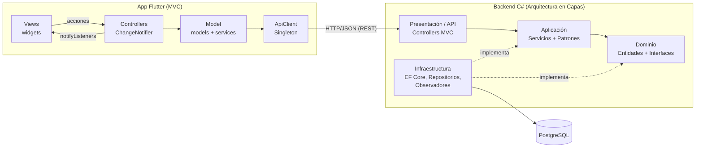
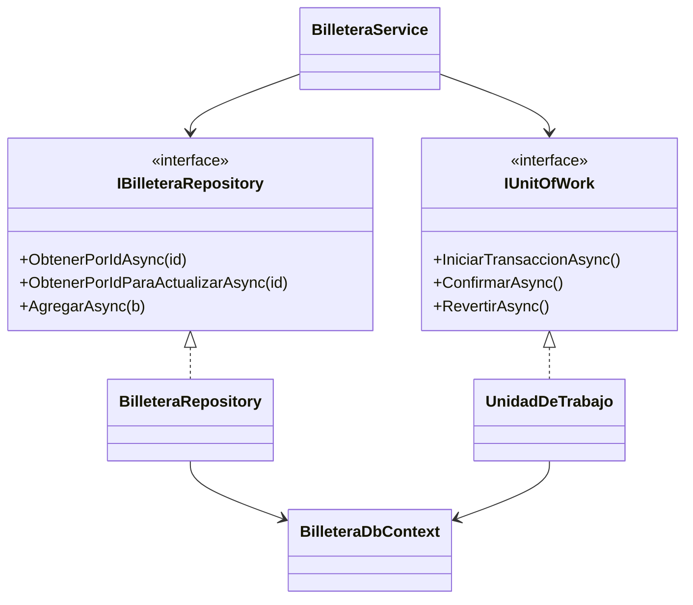
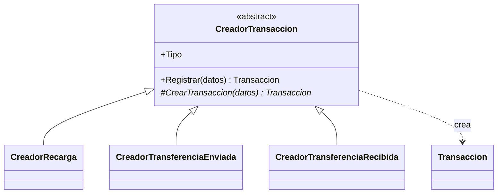
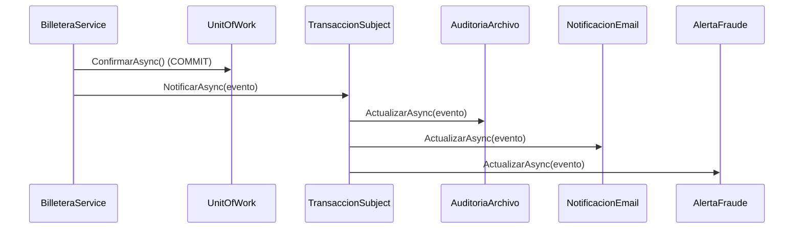

# Billetera Digital — Caso práctico de Diseño y Arquitectura de Software

Aplicación completa (backend + base de datos + app móvil) para demostrar en clase
**patrones arquitectónicos** (Capas, MVC, API REST) y **5 patrones de diseño**.

| Componente | Tecnología |
|---|---|
| Backend | C# · ASP.NET Core 8 Web API · Entity Framework Core 8 |
| Base de datos | PostgreSQL 16 |
| Frontend | Flutter 3 (Dart 3) · `http` · `provider` |
| Comunicación | API REST + JSON (errores en formato RFC 7807 *ProblemDetails*) |

Funcionalidades: **registro de clientes** (con apertura automática de billetera),
**inicio de sesión**, **recarga de saldo**, **transferencias** entre billeteras con
comisión y **historial de transacciones** paginado y filtrable.

---

## 1. Arquitectura general



### 1.1 Arquitectura en capas (backend)

```
backend/src
├── BilleteraDigital.Domain          ← núcleo: no depende de NADA
│   ├── Entidades/   Cliente, Billetera, Transaccion  (entidades ricas)
│   ├── Enums/       TipoTransaccion
│   ├── Excepciones/ ReglaDeNegocioException, SaldoInsuficienteException
│   └── Interfaces/  IClienteRepository, IBilleteraRepository, ITransaccionRepository, IUnitOfWork
├── BilleteraDigital.Application     ← casos de uso; depende solo de Domain
│   ├── DTOs/        contratos de entrada/salida de la API
│   ├── Servicios/   ClienteService, BilleteraService
│   └── Patrones/    Strategy/, FactoryMethod/, Observer/
├── BilleteraDigital.Infrastructure  ← detalles técnicos; implementa las interfaces
│   ├── Persistencia/ BilleteraDbContext (EF Core), UnidadDeTrabajo
│   ├── Repositorios/ ClienteRepository, BilleteraRepository, TransaccionRepository
│   ├── Seguridad/    Pbkdf2PasswordHasher
│   └── Observadores/ AuditoriaArchivo, NotificacionEmail, AlertaFraude
└── BilleteraDigital.Api             ← presentación (MVC) y raíz de composición
    ├── Controllers/  ClientesController, BilleterasController, TransaccionesController
    ├── Middleware/   ManejoErroresMiddleware (excepción → código HTTP)
    └── Configuracion/RegistroAplicacion (inyección de dependencias)
```

**Regla de dependencia:** las flechas de `ProjectReference` apuntan siempre hacia el
Dominio. Aplicación define *qué* necesita (`IUnitOfWork`, `IPasswordHasher`) e
Infraestructura decide *cómo* (EF Core, PBKDF2). Esto es el **Principio de
Inversión de Dependencias** y permite, por ejemplo, cambiar PostgreSQL por otra
base de datos sin tocar una línea de los casos de uso.

> 💡 Demostración para clase: durante el desarrollo se validó la API reemplazando la
> capa de Infraestructura por repositorios en memoria. Controladores y servicios no
> cambiaron. Es la mejor prueba de que las capas están bien desacopladas.

### 1.2 MVC

| | Backend (ASP.NET Core) | Frontend (Flutter) |
|---|---|---|
| **Model** | DTOs (`Application/DTOs`) + entidades | `lib/models` + `lib/services` (acceso REST) |
| **View** | Representación JSON que devuelve la API | `lib/views` (widgets: solo dibujan) |
| **Controller** | `Api/Controllers` (reciben HTTP, delegan, responden) | `lib/controllers` (`ChangeNotifier`) |

Los controladores de ambos lados son **delgados**: no tienen reglas de negocio ni
SQL / URLs. En Flutter, la View invoca al Controller (`context.read`), el Controller
llama al Model y avisa con `notifyListeners()`, y la View se redibuja (`context.watch`).

### 1.3 API REST

| Método | Ruta | Descripción | Códigos |
|---|---|---|---|
| POST | `/api/clientes` | Registrar cliente (+ billetera) | 201, 409, 422 |
| POST | `/api/clientes/login` | Iniciar sesión | 200, 401 |
| GET | `/api/clientes/{id}` | Cliente con billetera | 200, 404 |
| GET | `/api/billeteras/{id}` | Saldo de la billetera | 200, 404 |
| GET | `/api/billeteras/cuenta/{numero}` | Titular de una cuenta (antes de transferir) | 200, 404 |
| GET | `/api/billeteras/{id}/transacciones?pagina=&tamano=&tipo=` | Historial paginado | 200, 404 |
| POST | `/api/transacciones/recargas` | Recargar saldo | 201, 404, 422 |
| POST | `/api/transacciones/transferencias` | Transferir dinero | 201, 404, 422 |
| GET | `/api/transacciones/comision?monto=` | Previsualizar comisión | 200, 422 |

Ejemplo de error (todas las capas lo producen igual gracias al middleware):

```json
{ "title": "Regla de negocio", "status": 422,
  "detail": "Saldo insuficiente. Disponible: S/ 3,995.00, requerido: S/ 9,025.00." }
```

---

## 2. Los 5 patrones de diseño

| # | Patrón | Tipo (GoF / PoEAA) | Problema que resuelve aquí | Dónde verlo |
|---|---|---|---|---|
| 1 | **Repository** (+ Unit of Work) | Arquitectónico / PoEAA | Aislar el acceso a datos y guardar débito + crédito + movimientos de forma atómica | `Domain/Interfaces`, `Infrastructure/Repositorios`, `Infrastructure/Persistencia/UnidadDeTrabajo.cs` |
| 2 | **Strategy** | Comportamiento | La comisión cambia según el monto (y podrá cambiar por promociones, tipo de cliente…) | `Application/Patrones/Strategy` |
| 3 | **Factory Method** | Creacional | Cada tipo de movimiento (recarga, enviada, recibida) se construye distinto | `Application/Patrones/FactoryMethod` |
| 4 | **Observer** | Comportamiento | Tras una operación hay que auditar, notificar y vigilar fraude sin acoplar el servicio a esas tareas | `Application/Patrones/Observer`, `Infrastructure/Observadores` |
| 5 | **Singleton** | Creacional | Un único cliente HTTP compartido por toda la app Flutter (y un único Subject en el backend) | `frontend/.../lib/core/api_client.dart`, registro `AddSingleton` |

### 2.1 Repository + Unit of Work



Puntos para discutir en clase:
- `ObtenerPorIdParaActualizarAsync` usa `SELECT … FOR UPDATE` (bloqueo pesimista).
  Sin él, dos transferencias simultáneas podrían leer el mismo saldo y gastar dos veces.
- Las dos billeteras se bloquean **siempre en el mismo orden** (por Id) para evitar
  *deadlocks* entre transferencias cruzadas A→B y B→A.
- `CHECK (saldo >= 0)` en PostgreSQL es la última línea de defensa.

### 2.2 Strategy — política de comisiones

| Estrategia | Rango | Comisión |
|---|---|---|
| `SinComisionStrategy` | hasta S/ 500 | S/ 0 |
| `ComisionPorcentualStrategy` | S/ 500.01 – 5,000 | 0.5 % |
| `TarifaPlanaStrategy` | más de S/ 5,000 | S/ 25 (tope) |

`CalculadoraComision` (el **contexto**) recibe todas las estrategias por inyección
de dependencias y delega en la que aplica. **Ejercicio:** agregar una
`PromocionFinDeMesStrategy` creando una sola clase y registrándola en
`RegistroAplicacion.cs` — sin modificar el servicio (principio Abierto/Cerrado).
El endpoint `GET /api/transacciones/comision` y la pantalla de transferencia de
Flutter muestran qué estrategia se aplicó.

### 2.3 Factory Method — creación de movimientos



`Registrar()` aplica las validaciones comunes y llama al *factory method*
`CrearTransaccion()`, que cada subclase implementa (la enviada registra la comisión y
el destino; la recibida nunca cobra comisión; la recarga no tiene contraparte).
`ProveedorCreadores` entrega el creador según el `TipoTransaccion`.

### 2.4 Observer — reacciones a cada transacción



- Se notifica **después del COMMIT**: si la BD falla, nadie recibe un email falso.
- Si un observador lanza una excepción, los demás igual se ejecutan.
- Para ver el efecto: consola de la API (emails simulados, alertas ≥ S/ 3,000) y el
  archivo `logs/auditoria.jsonl`.

### 2.5 Singleton

En Flutter (`lib/core/api_client.dart`) se implementa **explícitamente** con las tres
piezas clásicas: constructor privado `ApiClient._interno()`, campo
`static final _instancia` y constructor `factory ApiClient()`. `ClienteService` y
`BilleteraService` hacen `ApiClient()` y reciben el mismo objeto (ver
`test/patrones_test.dart`).

En el backend el ciclo de vida *Singleton* lo administra el contenedor de inyección
de dependencias (`AddSingleton<ITransaccionSubject, TransaccionSubject>()`): buena
ocasión para discutir **Singleton clásico vs. Singleton gestionado por DI** (este
último es testeable y no usa estado global estático).

### Patrones complementarios presentes (para mencionar)
DTO, Inyección de Dependencias, Middleware (*Chain of Responsibility* del pipeline
de ASP.NET), Entidades ricas (DDD).

---

## 3. Cómo ejecutar

### 3.1 Base de datos

Con Docker (crea la BD y ejecuta los scripts de `database/` automáticamente):

```bash
docker compose up -d
```

Sin Docker: crear usuario `billetera` / `billetera123` y la base `billetera_digital`,
luego ejecutar `database/01_esquema.sql` y `database/02_datos_prueba.sql`.

Datos de prueba: `ana@demo.pe` y `luis@demo.pe`, contraseña **`Clave123!`**
(cuentas `1900000001` con S/ 1,500 y `1900000002` con S/ 800).

### 3.2 Backend

Requiere .NET 8 SDK.

```bash
cd backend
dotnet restore
dotnet run --project src/BilleteraDigital.Api     # http://localhost:5000/swagger
dotnet test                                       # pruebas de los patrones
```

La cadena de conexión está en `src/BilleteraDigital.Api/appsettings.json`.

### 3.3 Frontend Flutter

Requiere Flutter 3.22 o superior.

```bash
cd frontend/billetera_app
flutter create . --platforms=android,web,windows   # genera las carpetas de plataforma (solo la 1.ª vez)
flutter pub get
flutter run -d chrome          # o un emulador Android
flutter test
```

- La URL de la API se elige sola: `localhost:5000` (web/escritorio) o `10.0.2.2:5000`
  (emulador Android). En un celular físico:
  `flutter run --dart-define=API_URL=http://IP_DE_TU_PC:5000/api` y ejecutar la API con
  `dotnet run --project src/BilleteraDigital.Api --urls http://0.0.0.0:5000`.
- **Android:** como la API usa HTTP (no HTTPS) en desarrollo, agregar
  `android:usesCleartextTraffic="true"` a la etiqueta `<application>` de
  `android/app/src/main/AndroidManifest.xml`.

### 3.4 Guion de demostración (≈10 min)

1. Swagger → `POST /api/clientes` registra a un estudiante: ver la billetera creada.
2. `GET /api/transacciones/comision?monto=300`, `1000` y `8000`: tres estrategias distintas.
3. En Flutter: iniciar sesión como Ana, recargar S/ 3,500 → mirar la consola de la API
   (email simulado + alerta del observador de fraude) y `logs/auditoria.jsonl`.
4. Transferir S/ 1,000 a `1900000002`: el panel muestra “Porcentual 0.5 %”.
5. Iniciar sesión como Luis → historial filtrado por “Recibida”.
6. En `psql`: `SELECT * FROM v_historial;` → ver las dos filas con la misma `referencia`.
7. Intentar transferir más que el saldo → 422 generado en el **Dominio** y traducido
   por el **middleware**.

---

## 4. Ejercicios propuestos para los estudiantes

1. **Strategy:** comisión 0 para clientes con más de 6 meses de antigüedad.
2. **Factory Method + Observer:** nuevo tipo `Retiro` con su creador y un
   `PuntosFidelidadObserver`.
3. **Seguridad:** agregar autenticación JWT (`Microsoft.AspNetCore.Authentication.JwtBearer`)
   y tomar la billetera de origen del token en lugar del cuerpo de la petición.
   *Hoy el endpoint confía en el `billeteraOrigenId` enviado: es intencionalmente
   simple para el curso y **no** debe usarse así en producción.*
4. **Decorator:** envolver `IBilleteraRepository` con un `BilleteraRepositoryConCache`.
5. **Idempotencia:** cabecera `Idempotency-Key` para evitar transferencias duplicadas
   si el usuario pulsa dos veces.
6. **Pruebas de concurrencia:** lanzar 50 transferencias simultáneas y comprobar que el
   saldo nunca queda negativo (y qué pasa si se quita el `FOR UPDATE`).
